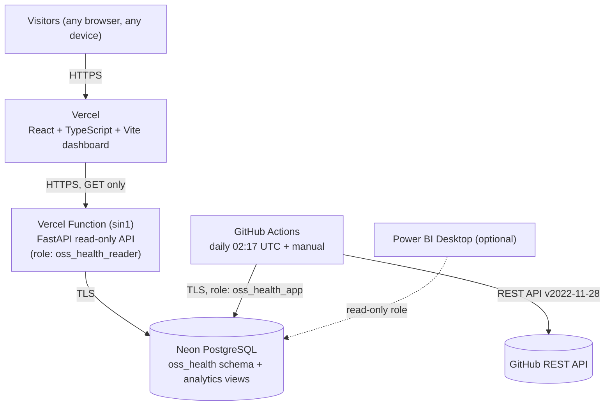

# Open-Source Project Health Analytics — Automated GitHub Data Pipeline

A production-style analytics platform for the health of popular open-source projects. A Python
pipeline extracts public GitHub repository, issue and pull-request data, validates it with Pandera,
loads it idempotently into PostgreSQL, and records every run and its data-quality checks. A public,
read-only FastAPI service and a responsive React dashboard present the results.

## Live Dashboard

**[Open Live Dashboard](https://oss-health-dashboard-one.vercel.app)** · https://oss-health-dashboard-one.vercel.app

**[Live API](https://oss-health-api.vercel.app)** (read-only) · https://oss-health-api.vercel.app ·
interactive docs at [`/docs`](https://oss-health-api.vercel.app/docs)

The dashboard is publicly accessible over HTTPS in any modern browser. You don't need to clone,
install or run this project locally to view it.

Both run on Vercel (Hobby) and read from Neon PostgreSQL (Free). Data is refreshed by GitHub
Actions, so nothing depends on a personal computer being on. Verification results, including phone,
tablet and desktop viewports, are recorded in [docs/DEVELOPMENT_LOG.md](docs/DEVELOPMENT_LOG.md).

---

## Architecture



- **Ingestion** runs in GitHub Actions (`.github/workflows/ingest.yml`), not on a laptop. It calls
  the same `oss-health run` CLI and `run_pipeline()` function used locally.
- **Neon PostgreSQL** is the system of record for data, run history and quality results.
- **The API** can only read the `analytics` views. Every session is forced read-only, and there is no
  endpoint that runs the pipeline or changes data.
- **The dashboard** is a static single-page app. It calls only the API, over HTTPS.

## Technology

| Layer | Technology |
|-------|------------|
| Pipeline | Python 3.12, requests, pandas, NumPy, Pandera, SQLAlchemy 2 Core, psycopg 3, Alembic |
| Database | PostgreSQL 17 (Neon in production; CI uses a `postgres:17` service container) |
| API | FastAPI as a Vercel Function (Python 3.12, region `sin1` next to Neon Singapore) |
| Frontend | React 18, TypeScript, Vite, Recharts, React Router; hosted on Vercel |
| Quality | pytest + pytest-cov, `responses` (HTTP mocking), Vitest + Testing Library, Ruff, pip-audit, npm audit, Gitleaks |
| Automation | GitHub Actions: CI, scheduled/manual ingestion, database migrations |
| Optional BI | Power BI Desktop (Import mode) over the `analytics` views |

## What the data covers, and its limits

Repositories (configurable in [backend/config/pipeline.toml](backend/config/pipeline.toml)):
`pandas-dev/pandas`, `scikit-learn/scikit-learn`, `fastapi/fastapi`, `psf/requests`, `microsoft/vscode`.

- **Initial history:** issues and pull requests **updated in the previous 90 days**, plus **every
  currently open** issue and pull request, however old. After that, runs are incremental: they read
  what changed since a stored watermark, with a 24-hour overlap.
- **Issues vs. pull requests:** GitHub's issues endpoint also returns pull requests. Those items are
  excluded from issues, and pull requests are loaded only from the pull-request endpoint. A
  post-load check fails if any `(repository_id, number)` appears in both tables.
- **Stars and forks** are real daily snapshots, at most one per repository per UTC day. History
  starts at the first run. Nothing is back-filled or estimated.
- **This is not a complete history** of every past issue and PR event. Weekly trends are drawn only
  from each repository's *coverage start date*. A reopened-then-closed issue counts only at its final
  close. Deleted, transferred and converted-to-discussion issues are not detected incrementally.

### Metric definitions

| Metric | Definition |
|--------|------------|
| Open issues | Issues (never PRs) whose current state is `open` |
| Backlog age | Days since an open issue was created (UTC), in buckets 0–7, 8–30, 31–90, 91–180, 181–365, >365 |
| Issues closed per week | Issues whose final `closed_at` falls in the Monday-start UTC week |
| PR merge rate | merged ÷ (merged + closed without merge), for PRs **closed** in the window. Open PRs are excluded. |
| Median time to merge | Median of `merged_at − created_at` for PRs merged in the window |
| Pipeline success rate | `success` runs ÷ finished runs (30 days). `partial_success` is never counted as success. |
| Freshness | `fresh`, or `degraded` (latest run not successful), `stale` (> 36 h since last success), `no_successful_run` |

Missing data is shown as "—", never as 0. A partial or failed run is never shown as healthy.

Source: [GitHub REST API](https://docs.github.com/en/rest). This project is not affiliated with
GitHub or the listed projects.

## Repository layout

```text
backend/            Python package `oss_health` (pipeline + API), migrations, tests; Vercel project root
  index.py, vercel.json  Vercel Function entrypoint (re-exports oss_health.api.app:app) and settings
  config/pipeline.toml   repositories, history window, retries, thresholds
  src/oss_health/        cli, pipeline (run_pipeline), github/, transform, validation, load,
                         tracking, report, api/, sql/ (analytics views, grants), migrate
  src/oss_health/migrations/  0001 ops tables · 0002 source tables · 0003 views + grants (packaged)
  tests/                 unit/ (no network, no DB) · integration/ (dedicated *_test DB only)
frontend/           React + TypeScript + Vite dashboard, Vitest tests; Vercel project root (vercel.json)
scripts/            setup, local_postgres, run_pipeline, test, verify (PowerShell)
.github/workflows/  ci.yml · ingest.yml · migrate.yml
docs/               specifications, deployment, security, run & verify guide, development log
```

## Local development (Windows, PowerShell)

```powershell
scripts\setup.ps1            # .venv (Python 3.12), backend + frontend packages, .env from template if missing
scripts\local_postgres.ps1   # optional: project-local PostgreSQL with osp_health_dev and osp_health_test
# edit .env (git-ignored): MIGRATION/PIPELINE/API/TEST database URLs, optional GITHUB_TOKEN
.venv\Scripts\oss-health.exe db upgrade            # migrations (MIGRATION_DATABASE_URL)
.venv\Scripts\oss-health.exe db bootstrap-roles    # oss_health_app / oss_health_reader + grants
scripts\run_pipeline.ps1 --repo psf/requests       # one repository; omit --repo for all
scripts\run_pipeline.ps1 --dry-run                 # extract/transform/validate only, no database
```

Run the API and dashboard locally:

```powershell
cd backend;  ..\.venv\Scripts\uvicorn.exe oss_health.api.app:app --port 8000   # uses API_DATABASE_URL
cd frontend; npm run dev                                                       # http://localhost:5173
```

Full instructions: [docs/RUN_AND_VERIFY.md](docs/RUN_AND_VERIFY.md).

## Testing and verification

```powershell
scripts\test.ps1     # Ruff, backend unit + integration tests, frontend types/tests/build/bundle scan
scripts\verify.ps1   # environment, dependencies, config, migration status, tests, report, secret scan
```

Integration tests run only when `TEST_DATABASE_URL` names a local database ending in `_test`.
They verify the resolved `current_database()` before resetting anything. CI runs the same suites
against a disposable PostgreSQL 17 service container and enforces ≥ 85% backend coverage.

## Pipeline runs, exit codes and quality reports

| Exit | Status | Meaning |
|------|--------|---------|
| 0 | `success` | All repositories loaded; no error-severity check failed |
| 2 | `partial_success` | Some data loaded, but a repository failed or an error check failed |
| 1 | `failed` | Fatal error (e.g. bad credentials) or no repository succeeded |
| 3 | not started | Invalid configuration, database unreachable, or another run in progress |

Every run writes `backend/reports/latest_quality_report.json`, plus a per-run copy, including runs
that fail or never start. Long-term history lives in the database (`oss_health.pipeline_runs`,
`data_quality_checks`, `rejected_records`). It is visible on the dashboard's **Data Quality & Runs**
page and through `GET /api/v1/runs` and `GET /api/v1/quality/latest`.

### Triggering an ingestion manually

GitHub → **Actions** → **Ingest GitHub data** → **Run workflow**. Optionally enter repositories and
choose **full refresh**. Or run `gh workflow run ingest.yml`. The schedule is daily at 02:17 UTC.
GitHub disables scheduled workflows in public repositories after 60 days without repository
activity. Re-enable it with **Enable workflow** on the same page, or `gh workflow enable ingest.yml`.

## Public API (read-only)

`GET /health/live`, `/health/ready`, `/api/v1/summary`, `/api/v1/repositories`,
`/api/v1/repositories/{id}`, `/api/v1/analytics/{activity|stars-forks|issues|pull-requests}`,
`/api/v1/runs`, `/api/v1/quality/latest`. Interactive docs are at `/docs`.

- Other methods return 405.
- Parameters are validated and bounded (page size ≤ 100, date range ≤ 730 days, ≤ 104 weeks, query string ≤ 1 KB).
- CORS is restricted to the dashboard's origin.
- Errors are generic JSON without SQL or stack traces.

See [docs/SECURITY.md](docs/SECURITY.md).

## Configuration and secrets

| Variable | Used by | Notes |
|----------|---------|-------|
| `GITHUB_TOKEN` | pipeline | Optional. In Actions: secret `GH_API_TOKEN`, or the built-in job token. |
| `PIPELINE_DATABASE_URL` | pipeline | Role `oss_health_app` (write source/ops tables only) |
| `MIGRATION_DATABASE_URL` | `db upgrade`, `db bootstrap-roles` | Schema-owner credential |
| `API_DATABASE_URL` | API | Role `oss_health_reader` (`analytics` views only); a sensitive Vercel env var on `oss-health-api` |
| `CORS_ALLOWED_ORIGINS` | API | Exact dashboard origin (`https://oss-health-dashboard-one.vercel.app`) |
| `VITE_API_BASE_URL` | frontend build | **Public.** The API URL only (`https://oss-health-api.vercel.app`); never a secret. |

Real values live in git-ignored env files locally, in GitHub repository secrets
(`MIGRATION_DATABASE_URL`, `PIPELINE_DATABASE_URL`), and in Vercel's encrypted project environment
variables (`API_DATABASE_URL`). Never put them in the repository or in `VITE_*` variables. See
[.env.example](.env.example).

## Optional: Power BI

Power BI Desktop can connect in Import mode to the `analytics` views with the read-only role. The
guide is in [docs/PowerBI_Dashboard_Spec.md](docs/PowerBI_Dashboard_Spec.md). No `.pbix` file is
included, and visitors never need Power BI.

## Hosting and costs

| Piece | Provider and plan | Cost |
|-------|-------------------|------|
| Dashboard (`oss-health-dashboard`) | Vercel Hobby, static SPA | $0 |
| API (`oss-health-api`) | Vercel Hobby, Python Function in `sin1` | $0 |
| Database | Neon Free, `aws-ap-southeast-1` | $0, no card |
| CI, ingestion, migrations | GitHub Actions, public repository | $0 on standard runners |

Hobby has no billing cycle. When an included limit is exceeded (for example 1M function
invocations, 4 active-CPU hours or 100 GB transfer per month), usage is **paused rather than
billed**. Hobby is for personal, non-commercial use. No paid product, add-on or domain is used, and
no Google Cloud resources exist. Limits were checked on the official pages on 2026-10-28/29; see
[docs/DEPLOYMENT.md](docs/DEPLOYMENT.md).

## Troubleshooting

| Symptom | Likely cause / fix |
|---------|-------------------|
| `exit 3` "run already in progress" | Another run holds the PostgreSQL advisory lock; wait. Crashed runs release it automatically. |
| `exit 3` "PIPELINE_DATABASE_URL is not set" | Set it in `.env`, or use `--dry-run`. |
| Many `RateLimitExceededError` | No token: 60 requests/hour. Set `GITHUB_TOKEN`. |
| Dashboard banner "stale" | No successful run in 36 h. Check the Actions run history and whether the schedule was disabled. |
| Dashboard "Configuration problem" | The Vercel build lacks a valid HTTPS `VITE_API_BASE_URL`. |
| API `/health/ready` 503 | `API_DATABASE_URL` is missing or wrong, or Neon is unreachable. |

More in [docs/RUN_AND_VERIFY.md](docs/RUN_AND_VERIFY.md#troubleshooting).

## Documentation

[PRD](docs/PRD.md) · [TRD](docs/TRD.md) · [Database schema](docs/Backend_DB_Schema.md) ·
[Data flow](docs/Data_Flow.md) · [Power BI spec](docs/PowerBI_Dashboard_Spec.md) ·
[Implementation plan](docs/implementation_plan.md) · [Decisions](docs/DECISIONS.md) ·
[Run & verify](docs/RUN_AND_VERIFY.md) · [Deployment](docs/DEPLOYMENT.md) · [Security](docs/SECURITY.md) ·
[Development log](docs/DEVELOPMENT_LOG.md)

## License

[MIT](LICENSE) © 2026 parammeet83
