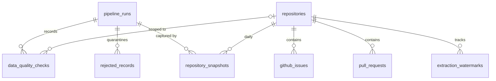

# Backend Database Schema (PostgreSQL 17 / Neon)

**Status:** Implemented in Alembic migrations `0001`–`0003` (authoritative DDL:
`backend/migrations/versions/`). Migration round trip verified on a local PostgreSQL. CI uses PostgreSQL 17.
**Related:** [TRD](TRD.md) · [Data Flow](Data_Flow.md) · [Security](SECURITY.md)

## 1. Schemas and roles

| Schema | Contents | Written by | Read by |
|--------|----------|-----------|---------|
| `oss_health` | 8 source and operational tables | `oss_health_app` (pipeline) | pipeline; the views (as their owner) |
| `analytics` | 8 views (the public data contract) | migrations only | `oss_health_reader` (API, Power BI) |

Roles: the **Neon owner** (migration credential) owns both schemas and runs Alembic.
**`oss_health_app`** and **`oss_health_reader`** are created by `oss-health db bootstrap-roles`.
Grants live in `src/oss_health/sql/grants.sql`. They are idempotent, re-applied by migration 0003
and by bootstrap, and set default privileges for future objects. `PUBLIC` has no privileges on
either schema. See [SECURITY.md](SECURITY.md#database-roles).

## 2. Tables



| Table | Grain / PK | Key constraints | Indexes |
|-------|-----------|-----------------|---------|
| `pipeline_runs` | run; `run_id` UUID | status ∈ {running, success, partial_success, failed}; trigger ∈ {manual, scheduled, ci}; `(status='running') = (finished_at IS NULL)`; `finished_at ≥ started_at`; exit_code ∈ {0,1,2}; non-negative counts, succeeded + failed ≤ requested | `started_at DESC`; partial on `status='running'` |
| `repositories` | GitHub `repository_id` | `node_id` unique; unique `lower(full_name)`; id > 0; `is_tracked` | — |
| `repository_snapshots` | `(repository_id, snapshot_date)` | counts ≥ 0; `snapshot_date = (captured_at AT TIME ZONE 'UTC')::date`; FKs to repositories and runs | `snapshot_date` |
| `github_issues` | GitHub issue `issue_id` | unique `(repository_id, issue_number)`; state ∈ {open, closed}; `updated_at ≥ created_at`; `closed_at ≥ created_at`; counts ≥ 0 | `(repo, state)`, `(repo, created_at)`, partial `(repo, closed_at)`, partial open `(repo, created_at)` |
| `pull_requests` | GitHub PR `pull_request_id` (≠ its issue id) | unique `(repository_id, pr_number)`; merged ⇒ `state='closed'` and `merged_at ≥ created_at`; generated `is_merged` | `(repo, state)`, `(repo, created_at)`, partial `(repo, merged_at)`, partial `(repo, closed_at)` |
| `data_quality_checks` | identity `check_result_id` | `UNIQUE NULLS NOT DISTINCT (run_id, check_name, entity, repository_full_name)`; stage/entity/severity/status enumerations; FK `repository_id` (set only after a committed load) | `run_id`; `(check_name, status)` |
| `rejected_records` | identity `rejected_record_id` | entity enumeration; `ON DELETE CASCADE` from runs; payload JSONB (redacted) | `run_id`; `(entity, check_name)`; `rejected_at` |
| `extraction_watermarks` | `(repository_id, resource)` | resource ∈ {issues, pull_requests}; `coverage_start_at ≤ high_watermark` | PK |

Conventions: GitHub numeric IDs are primary keys. Source timestamps keep GitHub names and are
`TIMESTAMPTZ` in UTC. Warehouse audit columns are prefixed `etl_`. Enumerations are TEXT + CHECK.
Lists are `TEXT[]`.

## 3. Idempotency and update handling

| Table | Conflict target | Update only when | Effect of an unchanged rerun |
|-------|-----------------|------------------|------------------------------|
| `repositories` | `repository_id` | any column is distinct | none |
| `repository_snapshots` | `(repository_id, snapshot_date)` | later `captured_at` **and** a metric changed | none; the day keeps one row |
| `github_issues` / `pull_requests` | primary key | `excluded.updated_at > stored.updated_at` (`>=` with `--full-refresh`) | none; stale copies never overwrite |
| `extraction_watermarks` | `(repository_id, resource)` | watermark newer, or coverage earlier | never moves backwards |
| `data_quality_checks` | unique key | always (re-evaluation within a run) | one row per check per run |

Inserted vs. updated counts come from `RETURNING (xmax = 0)`. The "unchanged" count is
attempted − inserted − updated. If a different ID collides on `(repository_id, number)`, an
integrity error rolls back that repository's transaction and marks the repository failed.

**History strategy:** issues and PRs are current-state (SCD1), and lifecycle timestamps drive the
metrics. Stars and forks are append-per-day snapshots that start at the first run. Reopen cycles,
deletions and transfers are not tracked (documented limitation).

## 4. Issues versus pull requests

Issues come from `/issues` minus items carrying a `pull_request` key. PRs come only from `/pulls`.
Issue and PR numbers share one sequence per repository, but their IDs differ between endpoints, so
the post-load check joins on `(repository_id, number)`:

```sql
SELECT count(*) FROM oss_health.github_issues i
JOIN oss_health.pull_requests p ON p.repository_id = i.repository_id AND p.pr_number = i.issue_number;  -- must be 0
```

## 5. Analytics view contract (8 views)

Source: `src/oss_health/sql/analytics_views.sql`. All views exclude untracked repositories.
Timestamps are exposed as `…_utc` (timestamp without time zone, UTC). "Today" is the UTC date at
query time.

| View | Grain | Columns |
|------|-------|---------|
| `dim_repository` | repository | metadata; `coverage_start_date` (first full UTC day after **both** backfills; NULL until then); `issues_watermark_utc`, `prs_watermark_utc`; `first_snapshot_date`, `latest_snapshot_date`, `snapshot_count`; `stars_latest`, `forks_latest`, `watchers_latest`; `open_issues`, `closed_issues_in_coverage`, `open_prs`, `open_draft_prs`, `merged_prs_in_coverage`, `closed_unmerged_prs_in_coverage` (each NULL until its backfill completed — never a fake 0) |
| `dim_date` | day | `date`, year/quarter/month/month_name, `iso_year`, `iso_week`, `week_start_date` (Monday), `day_of_week` |
| `fact_repository_snapshot` | repository × day | counts, `previous_snapshot_date`, `stars_delta`, `forks_delta` (vs. previous real snapshot) |
| `fact_issue` | issue | state, `is_open`, `state_reason`, bot flag, association, comments, created/closed (`_utc` and dates), `hours_to_close`, `open_age_days`, `backlog_age_bucket` + `_order` |
| `fact_pull_request` | PR | `outcome` ∈ {open, merged, closed_unmerged}, draft, bot, created/closed/merged (`_utc` and dates), `hours_to_merge`, `hours_to_close`, `open_age_days` |
| `agg_weekly_activity` | repository × Monday week | `issues_opened`, `issues_closed`, `prs_opened`, `prs_merged`, `prs_closed_unmerged`, `is_within_coverage`, `is_complete_week`. A complete week grid from the coverage start to the current week, so real zero weeks are explicit. |
| `fact_pipeline_run` | run | status, trigger, times, `duration_seconds`, exit code, counts, `rejection_rate` (NULL if nothing extracted), sanitized `error_type`/`error_message`, `checks_evaluated`, `checks_passed`, `error_checks_failed`, `warning_checks_failed` |
| `fact_data_quality_check` | check result | run date, check name/stage/entity/repository, severity, status, counts, observed/threshold, details |

## 6. Retention

`rejected_records` older than 90 days are deleted at run start. Runs and checks are kept, because
they are small and referenced by `etl_run_id`. Reports and logs on CI runners are ephemeral; the
database is the record.
