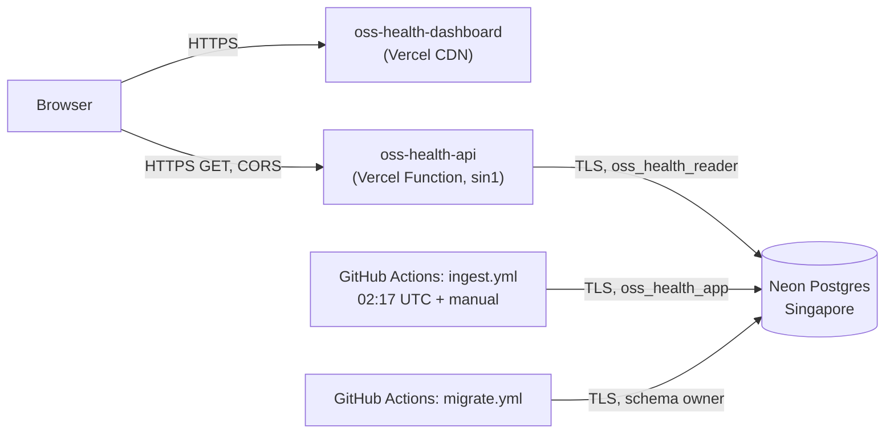

# Deployment Guide

**Status (2026-10-29): live.**

| Component | Where | URL / identifier |
|-----------|-------|------------------|
| Dashboard | Vercel Hobby project `oss-health-dashboard` (source `frontend/`, preset Vite) | https://oss-health-dashboard-one.vercel.app |
| Read-only API | Vercel Hobby project `oss-health-api` (source `backend/`, preset FastAPI, region `sin1`) | https://oss-health-api.vercel.app |
| Database | Neon Free project `open-source-project-health-analytics` (`wandering-leaf-74668817`), branch `production`, Postgres 17, `aws-ap-southeast-1` | — |
| CI, ingestion, migrations | GitHub Actions in `parammeet83/open-source-project-health-analytics` | `ci.yml`, `ingest.yml`, `migrate.yml` |

The earlier Google Cloud Run design was **retired without creating any Google Cloud resources**
([ADR-027](DECISIONS.md#adr-027-host-the-api-on-vercel-instead-of-google-cloud-run)). The Cloud Run
workflow, the Dockerfile and the deploy script were removed.



## Costs and plan limits (checked on official pages 2026-10-28/29)

| Service | Plan facts | This project |
|---------|-----------|--------------|
| Vercel Hobby | Free; **no billing cycle — exceeding a limit pauses the feature (typically for 30 days) rather than billing**. Per month: 1,000,000 function invocations, 4 active-CPU hours, 360 GB-hrs provisioned memory, 100 GB fast data transfer, 1,000,000 CDN requests. 300 s max function duration, 100 deployments/day, 200 projects. **Personal, non-commercial use only.** | Two projects. Function `maxDuration` 30 s. No paid add-ons, domains or Pro features. |
| Neon Free | No credit card; 100 CU-hours per project per month; 1 GB storage per project; scale to zero after 5 min | Existing project and roles only |
| GitHub Actions | Standard runners are free for public repositories | CI, ingestion, migrations |

Nothing in this setup can incur a charge without an explicit plan upgrade by the owner.

## Vercel projects

### API (`backend/`)

- `backend/index.py` is the entrypoint Vercel discovers. It re-exports `app` from
  `oss_health.api.app`, the same FastAPI app used locally.
- `backend/pyproject.toml` `[project.dependencies]` (SQLAlchemy, psycopg 3 binary, FastAPI) is
  everything the API needs, and it is what Vercel installs. Pipeline and dev tools are optional extras
  and are not installed. Python 3.12 comes from `requires-python`.
- `backend/vercel.json`: `framework: "fastapi"`, `regions: ["sin1"]` (same region as Neon), function
  `index.py` with `maxDuration: 30`, and `excludeFiles` for tests/config/reports/logs.
- `backend/.vercelignore` keeps env files, reports, logs, tests and caches out of uploads.
- **Production environment variables** (encrypted; `API_DATABASE_URL` stored as *sensitive*):

  | Variable | Value |
  |----------|-------|
  | `API_DATABASE_URL` | Neon **`oss_health_reader`** URL, direct endpoint, `sslmode=require` (from `.env.roles`) |
  | `CORS_ALLOWED_ORIGINS` | `https://oss-health-dashboard-one.vercel.app` |
  | `DB_POOL_SIZE` / `DB_MAX_OVERFLOW` | `1` / `1` (small pools per function instance; the reader role allows 10 connections) |
  | `RATE_LIMIT_PER_MINUTE` | `120` (per instance; best effort) |
  | `STALE_AFTER_HOURS` | `36` |

  The writer and migration credentials are **not** present in either Vercel project.

### Dashboard (`frontend/`)

- `frontend/vercel.json`:
  - install `npm ci`, build `npm run build`, output `dist`
  - SPA rewrite to `/index.html`
  - security headers, with CSP `connect-src 'self' https://oss-health-api.vercel.app`
- **Production environment variable:** `VITE_API_BASE_URL=https://oss-health-api.vercel.app`. It is
  public by design. A production build refuses http or localhost values.

### How the projects were created (reproducible, CLI)

```powershell
npx vercel@65.5.0 login                                   # browser device authorization
npx vercel@65.5.0 project create oss-health-api
npx vercel@65.5.0 link --yes --project oss-health-api --cwd backend
# env values are piped on stdin (never typed as arguments):
#   vercel env add API_DATABASE_URL production --cwd backend --sensitive   < value on stdin
npx vercel@65.5.0 deploy --prod --yes --cwd backend       # uploads backend/ as the project root

npx vercel@65.5.0 project create oss-health-dashboard
npx vercel@65.5.0 link --yes --project oss-health-dashboard --cwd frontend
npx vercel@65.5.0 api /v9/projects/oss-health-dashboard -X PATCH -f framework=vite
#   vercel env add VITE_API_BASE_URL production --cwd frontend           < https://oss-health-api.vercel.app
npx vercel@65.5.0 deploy --prod --yes --cwd frontend      # uploads frontend/ as the project root
```

**Current deployment method: CLI from the subdirectory.** The projects' *Root Directory* setting is
deliberately **unset**. A CLI deploy from `backend/` or `frontend/` already uploads that directory
as the project root. Setting Root Directory as well makes the CLI look for `backend/backend`, and
the deploy fails with "The specified Root Directory does not exist".

`vercel link` writes `.vercel/` and a `.env.local` holding a short-lived `VERCEL_OIDC_TOKEN` in
each project directory. Both are git-ignored and excluded from uploads by `.vercelignore`.

### Automatic deployments from GitHub

**Not connected yet.** `vercel git connect` failed for both projects ("Failed to connect … make
sure you have access"), because the Vercel GitHub App on the owner's account has not been granted
access to this repository. Until it is connected, redeploy with the CLI commands above. Data
refreshes do **not** need a redeploy: ingestion writes to Neon, and the API reads it live.

To enable automatic deploys (owner action, free):

1. GitHub → **Settings → Applications → Installed GitHub Apps → Vercel → Configure** → under
   *Repository access*, add `open-source-project-health-analytics` → **Save**.
2. Vercel dashboard → `oss-health-api` → **Settings → Git** → *Connect Git Repository* →
   `parammeet83/open-source-project-health-analytics`. Then **Settings → Build and Deployment →
   Root Directory** = `backend` → Save.
3. Repeat for `oss-health-dashboard` with Root Directory = `frontend`.
4. From then on, every push to `main` deploys both projects, and pull requests get preview
   deployments, which Vercel Authentication protects by default on Hobby. For a manual CLI deploy
   after that, run `vercel deploy --prod` from the **repository root** with the matching project
   linked, not from the subdirectory.

## Database migrations (safe procedure)

1. Write an additive Alembic revision under `backend/src/oss_health/migrations/versions/`. Test it
   locally: `scripts\test.ps1` runs the upgrade → downgrade → upgrade round trip on the dedicated
   `*_test` database, and CI repeats it on PostgreSQL 17.
2. Optionally rehearse on a Neon branch: `neon branches create`, then point `MIGRATION_DATABASE_URL`
   at the branch.
3. Run GitHub Actions → **Migrate database** → *Run workflow* **before** deploying API code that
   depends on the new schema. The workflow runs automatically when files under `migrations/` or
   `sql/` change on `main`. It validates the secret (`oss-health db check-url`, yes/no flags only),
   runs `db upgrade` with the owner credential, then `db verify-roles`.
4. Then push the API change (Vercel redeploys).

`upgrade head` is idempotent. Ingestion takes its own PostgreSQL advisory lock and is independent
of deployments.

## Secrets map

| Secret | Location | Used by |
|--------|----------|---------|
| `MIGRATION_DATABASE_URL` | GitHub repository secret | `migrate.yml` |
| `PIPELINE_DATABASE_URL` | GitHub repository secret | `ingest.yml` |
| `GH_API_TOKEN` (optional) | GitHub repository secret | `ingest.yml` (falls back to the job token) |
| `API_DATABASE_URL` | Vercel `oss-health-api` → Production (sensitive) | API function |
| Local copies | `.env.local` (Neon owner URLs), `.env.roles` (role URLs) | Developer machine only; git-ignored |

## Rollback

- **API or dashboard:** Vercel dashboard → project → Deployments → previous deployment →
  **Promote to Production** (or `vercel rollback --cwd backend|frontend`).
- **Database:** prefer a forward-fixing migration. Neon restore lets you branch from an earlier
  point in time within the plan's history window.
- **Ingestion:** Actions → *Ingest GitHub data* → ⋯ → Disable workflow. Upserts are idempotent, so
  the next successful run self-heals.

## Verification after each deployment

See [RUN_AND_VERIFY.md §5](RUN_AND_VERIFY.md#5-live-verification-checklist). The results of the
first deployment are in [DEVELOPMENT_LOG.md](DEVELOPMENT_LOG.md).
