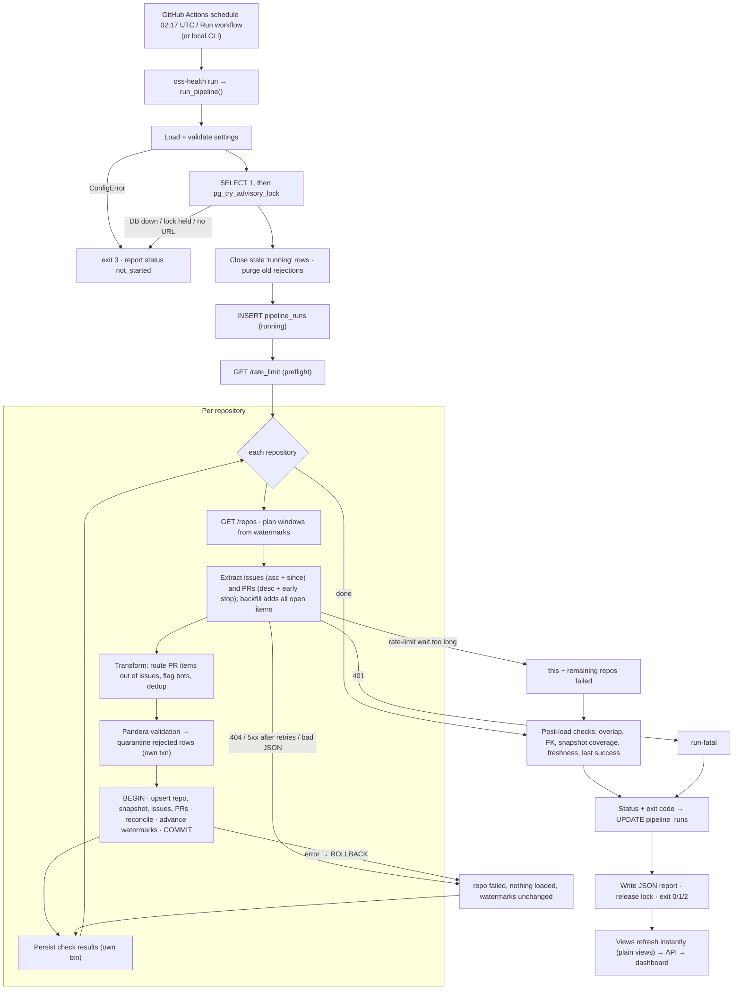

# Data Flow

**Status:** Describes the implemented flow (`backend/src/oss_health/pipeline.py`).
**Related:** [TRD](TRD.md) · [DB Schema](Backend_DB_Schema.md)

## 1. End-to-end

## 2. Windows and watermarks

| Situation | Issues | Pull requests |
|-----------|--------|---------------|
| Backfill (no watermark, or `--full-refresh`) | `since = now − 90 d` (asc) **+ all `state=open`** | desc until older than `now − 90 d` **+ all `state=open`** |
| Incremental | `since = watermark − 24 h` | desc until older than `watermark − 24 h` |

| Rule | Issues | PRs |
|------|--------|-----|
| Advance to the newest `updated_at` in the window | yes; also when page-capped (ascending order makes partial progress safe) | only if the window series is complete |
| Empty, complete window | advance to the extraction start time | same |
| Hold when | rejection rate > 5%, or the open-item series is incomplete | the same, plus an incomplete window |

Watermarks are written in the same transaction as the data. If the load fails, they are not written.

## 3. Failure paths

| Failure | Behaviour | Watermarks | Run status | Exit |
|---------|-----------|------------|------------|------|
| Invalid config / missing DB URL / DB unreachable / lock held | Report `not_started`; no run row | — | — | 3 |
| 401 | Stop; remaining repos "not attempted" | unchanged | failed | 1 |
| 404 / 410, 5xx or timeout after retries, invalid JSON | Repo failed; others continue | unchanged | partial (failed if none succeeded) | 2 / 1 |
| `Retry-After` / reset within 900 s | Wait, then retry (bounded) | — | unaffected | — |
| Rate-limit wait > 900 s or retries exhausted | This and the remaining repos fail | unchanged | partial / failed | 2 / 1 |
| Page cap (300) | Load what was read; `extraction_completeness` error | issues may advance; PRs held | partial | 2 |
| Invalid rows ≤ 5% | Quarantined; valid rows loaded | advance | unaffected | — |
| Invalid rows > 5% | Quarantined; valid rows loaded; error check | held for that resource | partial | 2 |
| Repository metadata invalid / structural schema failure | Repo failed | unchanged | partial / failed | 2 / 1 |
| DB error during load / reconciliation mismatch | ROLLBACK that repo; checks + rejections kept | unchanged | partial / failed | 2 / 1 |
| Issue/PR overlap or FK orphans | Error check fails | — | partial | 2 |
| Unexpected exception | Logged (redacted); finalize | — | failed | 1 |
| Run row cannot be finalized | Report written; exit ≥ 1; the next run's sweep closes it | — | failed (later) | ≥ 1 |
| Process killed | The lock is released with the session; the next run closes the row as `AbandonedRun` | — | failed | — |

**Invariant:** an API error, an exhausted rate limit, a malformed response or an incomplete series
is never recorded as an empty successful dataset.

## 4. Downstream

The views are plain (not materialized), so the API sees committed data immediately. The API caches
nothing server-side; responses carry `Cache-Control: max-age=60`, and the dashboard caches for 60 s.
The dashboard's freshness banner is derived from the latest finished run and the last successful
run, so a failed or partial run is always visible.
