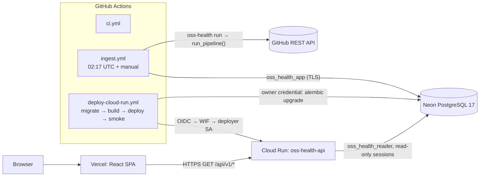

# Technical Requirements Document (TRD)

**Status:** Describes the implemented system (2026-10-28). Hosting steps are in [DEPLOYMENT.md](DEPLOYMENT.md).
**Related:** [PRD](PRD.md) · [DB Schema](Backend_DB_Schema.md) · [Data Flow](Data_Flow.md) · [Security](SECURITY.md) · [Decisions](DECISIONS.md)

## 1. Architecture

## 2. Code structure (`backend/src/oss_health`)

| Module | Responsibility |
|--------|----------------|
| `config.py` | Load `backend/config/pipeline.toml` (tomllib) + env/.env; validate types and ranges; `Settings.public_dict()` without secrets |
| `logging_setup.py` | Console + JSON-lines file logs; `run_id`/repository context; redaction filter |
| `redaction.py` | Token/URL/password masking plus registered secret values |
| `db.py` | URL normalization (psycopg driver, TLS enforcement for remote hosts), engine factory (UTC, statement timeout, optional read-only), test-database guard, advisory lock key |
| `github/client.py` | Session, headers, timeouts, retries/backoff, rate limits, `Link` pagination, page cap, payload-shape checks |
| `github/extract.py` | Window planning (backfill/incremental), issue and PR extraction, open-item backfill, completeness flags |
| `transform.py` | JSON → typed pandas frames, PR routing, bot flag, label lists, in-batch dedup, null counts |
| `validation.py` | Pandera schemas (repository, snapshot, issue, PR), quarantine records, dataset helpers |
| `load.py` | Guarded upserts with insert/update counts, reconciliation counts, watermarks, untracking |
| `tracking.py` | Advisory lock, stale-run sweep, run start/finalize, check and rejection persistence, retention purge |
| `report.py` | Atomic, redacted JSON report (`latest_quality_report.json` + per-run file) |
| `pipeline.py` | **`run_pipeline()`** — the single orchestration function; status and exit codes |
| `cli.py` | `oss-health run · check-config · db upgrade · db bootstrap-roles · db verify-roles` |
| `api/` | FastAPI app factory, settings, parameterized queries over `analytics` views |
| `sql/` | `analytics_views.sql` (8 views), `grants.sql` (idempotent least-privilege grants) |

Migrations: `backend/migrations/versions/0001_schemas_and_ops.py`, `0002_source_tables.py`,
`0003_analytics_views.py` (views + grants).

## 3. Configuration

`backend/config/pipeline.toml` (defaults): `per_page=100`, timeouts 10 s connect / 30 s read,
`max_retries=3`, backoff 2 s base / 60 s max with equal jitter, secondary-limit minimum wait 60 s,
`max_rate_limit_wait_seconds=900`, `rate_limit_buffer=25`, `max_pages_per_series=300`,
`history_days=90`, `incremental_overlap_hours=24`, `backfill_open_items=true`,
`max_rejection_rate=0.05`, `freshness_warning_hours=168`, `last_success_warning_hours=48`,
`batch_size=500`, `stale_run_after_hours=6`, `rejected_records_retention_days=90`,
`statement_timeout_ms=120000`. `require_token=false`: a token is recommended but never required.

Environment: `GITHUB_TOKEN`, `PIPELINE_DATABASE_URL`, `MIGRATION_DATABASE_URL`, `API_DATABASE_URL`,
`CORS_ALLOWED_ORIGINS`, `CORS_ALLOW_ORIGIN_REGEX`, `RATE_LIMIT_PER_MINUTE` (120),
`STALE_AFTER_HOURS` (36), `DB_POOL_SIZE` (2), `DB_MAX_OVERFLOW` (1), `API_STATEMENT_TIMEOUT_MS`
(5000), `EXPOSE_API_DOCS` (true), `TEST_DATABASE_URL`, `DEV_DATABASE_URL`. Frontend:
`VITE_API_BASE_URL` (public).

## 4. Extraction

| Purpose | Request |
|---------|---------|
| Preflight | `GET /rate_limit` (non-fatal on failure) |
| Metadata + snapshot | `GET /repos/{o}/{r}` |
| Issue window | `GET /repos/{o}/{r}/issues?state=all&since=…&sort=updated&direction=asc` |
| Open issues (backfill only) | `GET /repos/{o}/{r}/issues?state=open` |
| PR window | `GET /repos/{o}/{r}/pulls?state=all&sort=updated&direction=desc`, stopping once a page's oldest item is older than `since` (no `since` parameter exists) |
| Open PRs (backfill only) | `GET /repos/{o}/{r}/pulls?state=open` |

Headers: `Accept: application/vnd.github+json`, `X-GitHub-Api-Version: 2022-11-28`, `User-Agent`,
and `Authorization: Bearer` only if a token is set. Pagination links to other hosts are refused.

| Response | Behaviour |
|----------|-----------|
| 2xx | Return; record rate-limit headers; pause if remaining < buffer and the reset is within the max wait |
| Timeout / connection error / 500, 502, 503, 504 | Retry with backoff; after `max_retries` → `GitHubTransientError` |
| 403/429 + `Retry-After` | Wait that long (bounded attempts) |
| 403/429 + `X-RateLimit-Remaining: 0` | Wait until reset + 1 s if ≤ max wait, else `RateLimitExceededError` |
| 403/429 that looks like a secondary limit | Wait ≥ 60 s × 2^attempt |
| Other 403, 422, other 4xx | `GitHubClientError` (no retry) |
| 401 | `GitHubAuthError` (run-fatal) |
| 404 / 410 | `GitHubNotFoundError` |
| Invalid JSON / wrong shape | `GitHubResponseError` |

Windows (per repository, per resource): **backfill** when there is no watermark or `--full-refresh`
(`since = now − 90 d`, plus open items); otherwise **incremental**
(`since = watermark − 24 h`). Coverage start never moves later.

## 5. Transformation and validation

- Nullable dtypes (`Int64`, `string`, `boolean`, `datetime64[ns, UTC]`). Unparseable values become
  null and are then rejected by the schema with a reason.
- Field mappings: issues (`issue_id`, `node_id`, `issue_number`, `title`, `state`, `state_reason`,
  author fields, `is_bot_author`, sorted `label_names`, `assignee_count`, `comments_count`,
  `is_locked`, `milestone_title`, `html_url`, timestamps). PRs add `is_draft`, `base_ref`,
  `head_ref`, `head_repo_full_name`, `requested_reviewer_count`, `merged_at`, `merge_commit_sha`.
  `open_issues_count` is stored as `open_issues_and_prs_count`, because GitHub includes PRs in it.
- Dedup keeps the most recent `updated_at` per ID. Rows with a null ID are left for validation.
- Pandera (lazy) checks: required fields, ID/number > 0, state ∈ {open, closed}, `updated_at ≥ created_at`,
  `closed_at ≥ created_at`, merged ⇒ closed and `merged_at ≥ created_at`, counts ≥ 0, row belongs
  to the repository, no PR marker on issues. Frame-level failures are collapsed to one rejection per
  row per check. Structural failures (e.g. a missing column) fail the repository.

### Quality checks persisted per run

| Check | Stage | Entity | Severity |
|-------|-------|--------|----------|
| `extraction_completeness` | extract | issue, pull_request | error |
| `repository_renamed` (only when renamed) | extract | repository | warning |
| `issues_endpoint_prs_excluded`, `in_batch_duplicates_dropped`, `null_optional_fields` | transform | issue / pull_request | info |
| `required_fields_and_rules` | validate | each entity | warning |
| `rejection_rate` (≤ 5%) | validate | each entity | error |
| `unknown_state_reason` | validate | issue | warning |
| `primary_key_uniqueness` | validate | repository | error |
| `load_reconciliation` (all valid IDs present after upsert) | load | issue, pull_request | error |
| `watermark_advancement` | load | issue, pull_request | warning |
| `repository_processing` (only when the repository failed) | load | repository | error |
| `issue_pr_number_overlap`, `foreign_key_consistency` | post_load | run | error |
| `snapshot_coverage` | post_load | repository_snapshot | error |
| `data_freshness` (newest update ≤ 168 h) | post_load | repository | warning |
| `last_successful_run_age` (≤ 48 h; skipped on the first run) | post_load | run | warning |

## 6. Loading

- SQLAlchemy Core `INSERT … ON CONFLICT DO UPDATE … WHERE <guard> RETURNING (xmax = 0)` in batches
  of 500.
- **Guards:**
  - repositories: any column `IS DISTINCT FROM`
  - snapshots: later `captured_at` **and** a changed metric
  - issues/PRs: `updated_at` strictly newer (`>=` under `--full-refresh`)
  - watermarks: never backwards; coverage only earlier
- One transaction per repository covers repository → snapshot → issues → PRs → reconciliation →
  watermarks. Rejections and check results use their own transactions, so they survive a rollback.
- **Watermark rules:**
  - Hold the watermark when the rejection rate exceeds the threshold or the open-item series is incomplete.
  - PRs (descending) also hold when the window is incomplete.
  - Issues (ascending) may advance to the newest loaded item.
  - An empty, complete window advances to the extraction start time.
- Removing a repository from the config marks it `is_tracked = false`, but only after a full,
  fully successful run.

## 7. Run lifecycle, status and exit codes

1. Load settings.
2. Check the database (`SELECT 1`).
3. Take `pg_try_advisory_lock`.
4. Close `running` rows older than 6 h as `AbandonedRun`, and purge expired rejections.
5. Insert the run row (`running`).
6. Preflight.
7. Process each repository.
8. Post-load checks.
9. Untrack removed repositories.
10. Compute the status, finalize the row, write the report, release the lock.

| Status | Rule | Exit |
|--------|------|------|
| `success` | All repositories succeeded, no error-severity check failed | 0 |
| `partial_success` | ≥ 1 succeeded and (a repository failed or an error check failed) | 2 |
| `failed` | Fatal (401, unexpected exception) or none succeeded | 1 |
| not started | Config/precondition error before the run row exists (no DB, lock held, invalid config) | 3 |

`RateLimitExceededError` marks the current and remaining repositories as failed. `GitHubAuthError`
stops the run. If the run row cannot be finalized, the exit code becomes ≥ 1 and the next run's sweep
closes the row.

## 8. Report

`backend/reports/latest_quality_report.json` and `quality_report_<run_id>.json` (or
`quality_report_not_started_<ts>.json`). They are written atomically, and the whole document is
redacted. Fields:

- `report_version`, `run_id`, `status`, `exit_code`, `dry_run`, `full_refresh`, `trigger`
- `started_at`, `finished_at`, `duration_seconds`, `pipeline_version`, `config`
- `api` (requests, remaining, waits) and `totals` (extracted, rejected, inserted, updated, unchanged)
- `repositories[]` (status, modes, per-entity counts, watermark decisions, errors)
- `checks_summary`, `failed_checks`, `completeness_warnings`, `checks`, `rejections_sample`, `errors`

In GitHub Actions the report is summarized in the job summary and kept as a 30-day artifact. The
database is the long-term record.

## 9. API (FastAPI on Cloud Run)

| Endpoint | Parameters (validated) |
|----------|------------------------|
| `GET /health/live` | — |
| `GET /health/ready` | — (queries `analytics.dim_repository`; 503 if unavailable) |
| `GET /api/v1/summary` | `days` 7–365 (90) |
| `GET /api/v1/repositories` | `search` ≤ 100, `language` ≤ 40, `sort` ∈ {stars, forks, open_issues, open_prs, name}, `order`, `limit` 1–100, `offset` 0–10,000 |
| `GET /api/v1/repositories/{id}` | id 1–2^53 |
| `GET /api/v1/analytics/stars-forks` | `repository_id`, `start`, `end` (≤ 730 days; default last 365) |
| `GET /api/v1/analytics/activity` | `repository_id`, `weeks` 1–104 (26). Across repositories, only weeks covered for every repository are returned. |
| `GET /api/v1/analytics/issues` | `repository_id`, `days` |
| `GET /api/v1/analytics/pull-requests` | `repository_id`, `days` |
| `GET /api/v1/runs` | `limit` 1–100 (20) |
| `GET /api/v1/quality/latest` | — |

Freshness values: `fresh`, `degraded`, `stale` (> 36 h), `no_successful_run`. The container
(`backend/Dockerfile`) is a two-stage `python:3.12-slim` build installing only `.[api]`, running as
non-root UID 10001 with `uvicorn --host 0.0.0.0 --port $PORT`.

**Cloud Run settings:** 1 vCPU, 512 MiB, concurrency 40, 0–3 instances, 30 s timeout, CPU throttling.

## 10. Frontend

React 18 + TypeScript + Vite 6 + Recharts + React Router 7. The only network access is
`fetch(GET)` to `VITE_API_BASE_URL`. A production build refuses http or localhost URLs, and the dev
fallback is compiled out.

- **Pages:** Overview, Repository Explorer, Repository Detail, Issues & Backlog, Pull Requests,
  Data Quality & Runs, About & Sources, and a 404 page.
- **State and caching:** URL query parameters hold filters; responses are cached in memory for 60 s.
- **Responsive layout:** mobile-first CSS; a drawer menu below 900 px and a sidebar above; 44 px
  touch targets; light/dark via `prefers-color-scheme`.
- **Hosting (`vercel.json`):** SPA rewrite to `/index.html`, CSP and security headers, immutable
  caching for `/assets/*`.

## 11. Testing

| Suite | Count (2026-10-28) | Notes |
|-------|--------------------|-------|
| Backend unit (`tests/unit`) | 118 | Client (pagination, retries, Retry-After, primary/secondary limits, errors), extraction windows, transform, validation, config, redaction, pipeline logic and dry runs, report, CLI, API validation/CORS/405/limiter |
| Backend integration (`tests/integration`) | 30 | Migrations round trip, constraints, unique keys, end-to-end runs, idempotency, stale guard, partial failure, rollback, rejections, overlap check, advisory lock, stale sweep, untracking, views, null-not-zero, role permissions, API against the DB as the reader, CLI db commands |
| Frontend (Vitest) | 25 | Every route, KPIs, GET-only, error/empty states, honest freshness, single-snapshot message, filters → API params, quality table, mobile menu, navigation, formatting, config |

Backend line+branch coverage: 94% locally. CI gate: 85%.

## 12. Future enhancements

ETag conditional requests · GraphQL for review metrics · label bridge table · SCD2 history ·
periodic full reconciliation for deleted/transferred issues · notifications on nonzero exit ·
Cloud Armor or a shared rate-limit store · custom domain.
